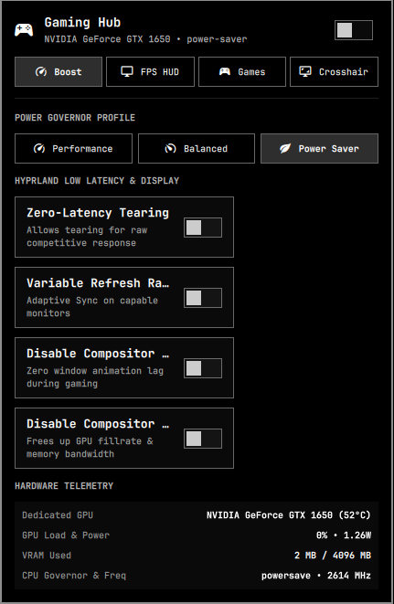

# 🎮 Omarchy Gaming Hub (`omarchy-plugin-gaming`)

A comprehensive gaming dashboard, performance optimizer, and MangoHud FPS overlay manager built specifically for Omarchy Linux with Hyprland.



## Highlights & Features

- **🎮 Master Game Boost Mode**:
  - One-click boost that switches CPU governor to `performance` via `powerprofilesctl`.
  - Dynamically disables Hyprland compositor animations (`animations:enabled 0`) for raw zero-latency frame pacing.
  - Dynamically disables window blur & shadows to maximize GPU fillrate and bandwidth.
  - Enables low-latency tearing (`general:allow_tearing 1`) for competitive esports response.
  - Enables Variable Refresh Rate (VRR / Adaptive Sync) on capable gaming displays.
  - Clean restoration of your previous desktop settings when toggled off.

- **📈 Complete MangoHud FPS Overlay Controller (User Highlight)**:
  - **Master FPS Toggle**: Instantly show or hide in-game telemetry HUD.
  - **Presets**: One-click switch between `Minimal` (FPS only), `Compact` (FPS + CPU/GPU temps/load), and `Full Telemetry` (VRAM, RAM, clocks, and frametime graph).
  - **Screen Position**: Move HUD between `Top-Left`, `Top-Right`, `Bottom-Left`, and `Bottom-Right`.
  - **FPS Limiter / Cap**: Quickly set target framerate (Unlocked, 60, 120, 144, 240 FPS).
  - **Live In-Game Toggle**: Simulates `Shift + F12` hotkey directly into the active game using `wtype` so you don't even need to restart your game!
  - **Granular Toggles**: Turn individual metrics on/off (Frametime curve, CPU, GPU, VRAM, RAM, Battery).
  - **One-Click Installer**: If `mangohud` or `gamemode` aren't installed yet, a friendly banner provides an instant installation button.

- **🎯 Active Game Radar**:
  - Real-time scanner for running Steam games (native & Proton), Heroic Games, Lutris, and Wine applications.
  - Displays game title, PID, and window class.
  - **⚡ Priority Booster**: Renices game process to `-5` for smoother frametime stability.
  - **💥 Force Terminate**: Safely closes or force-kills hung or frozen games in 1 click without needing to open a terminal.
  - Quick launch shortcuts for Steam and Heroic Games Launcher.

- **🎯 Floating On-Screen Crosshair Reticle**:
  - Click-through Wayland layer surface (`OverlayWindow` with empty input mask) centered on your primary gaming screen.
  - 4 customizable reticle styles: `Dot (•)`, `Cross (+)`, `Circle (⊙)`, and `T-Cross (T)`.
  - 5 high-visibility gaming colors: `Lime Green`, `Neon Red`, `Cyber Cyan`, `Theme Accent`, and `Crisp White`.
  - 4 size options: `12px`, `16px`, `22px`, and `28px`.

- **🎙️ Voice Chat & Audio Quick-Controls**:
  - One-click microphone mute toggle with real-time status.

- **⚡ Hardware Telemetry**:
  - Live dedicated GPU temperature, core utilization, VRAM usage, and power draw (NVIDIA GTX 1650).
  - Live CPU frequency (MHz) and scaling governor.

## Bar Widget Controls

| Action | Result |
|--------|--------|
| **Left-Click** | Opens / Closes the Gaming Hub panel |
| **Right-Click** | Instantly toggles **Game Boost Mode** |
| **Middle-Click** | Instantly toggles **FPS Overlay (MangoHud)** |
| **Hover** | Displays detailed hardware & active game tooltip |

---

## Installation & Setup

```bash
omarchy plugin add [https://github.com/SushantKr-Me/omarchy-plugin-gaming.git --enable
```

## License

MIT License © Sushant Kumar

